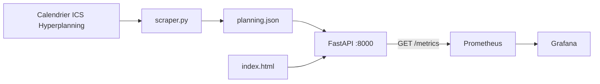
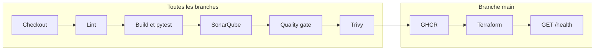

# Planning ESTIAM

> **English.** School project (ESTIAM, M2 cybersecurity): a FastAPI app downloads an ICS calendar from `ICS_URL` (the ESTIAM Hyperplanning feed, not hardcoded), keeps the current ISO week and the next one as JSON, and serves them through a small API plus a static page. The repo also contains a multi-stage non-root Docker image, a Jenkins pipeline (flake8, pytest, SonarQube quality gate, Trivy, GHCR push, Terraform, `/health` smoke test) and a Prometheus/Grafana stack.

**API et page web du planning de cours ESTIAM, alimentées par un calendrier ICS (`ICS_URL`, flux Hyperplanning non codé en dur), avec une image Docker non-root et un pipeline Jenkins DevSecOps.**

## Contexte

Projet scolaire réalisé à l’ESTIAM par [Edy Djihoua](https://github.com/wiscod), en Master 2 cybersécurité. L’application reste courte : un parser ICS, une API FastAPI et une page HTML. Le dépôt montre surtout comment cette application est lintée, testée, analysée, scannée, publiée et supervisée.

Licence [MIT](LICENSE) (copyright 2026 wiscod).

## Architecture

Au démarrage du conteneur, `docker-entrypoint.sh` exécute `src/scraper.py`. Le script lit `ICS_URL`, télécharge le calendrier (`requests`, timeout 10 s), parse les `VEVENT` avec `icalendar`, puis écrit **uniquement la semaine ISO en cours et la suivante** dans `public/data/planning.json`. FastAPI sert ce fichier. `public/index.html`, exposé sur `/`, appelle `/planning` et se recharge toutes les heures.

Lancé à la main, le même script affiche aussi un résumé texte dans le terminal.

Si le téléchargement échoue, le processus Python quitte avec le code 0 et `docker-entrypoint.sh` enchaîne sur Uvicorn. `/planning` répond alors `503` tant que le JSON est absent.



| Méthode | Chemin | Comportement dans le code |
|---|---|---|
| GET | `/` | Page statique `public/index.html` |
| GET | `/health` | `{"status": "ok"}` |
| GET | `/planning` | JSON des semaines enregistrées, ou `503` si le fichier manque |
| GET | `/planning/week/{n}` | Semaine ISO `n`, `404` si elle est absente, `503` si le fichier manque |
| POST | `/refresh` | Relance le téléchargement ICS et réécrit le JSON |
| GET | `/metrics` | Texte Prometheus : `planning_requests_total` (label `endpoint`, incrémenté sur `/planning` et `/planning/week`) et `planning_ics_refresh_total` |
| GET | `/docs` | Documentation interactive FastAPI, laissée au comportement par défaut |

Le parser ajoute 2 heures aux événements qui portent une heure, et range le lieu dans le champ `time` (`Distanciel` ou `Presentiel`). Un exemple de JSON est versionné dans `public/data/planning.json`. L’image Docker ne le copie pas : le `Dockerfile` ne prend que `public/index.html`, et l’entrypoint régénère le fichier.

### Image et Compose

`Dockerfile` : build multi-étapes sur `python:3.11-slim`, dépendances de `requirements.txt` (y compris pytest, pytest-cov et flake8), mise à jour apt puis de pip, setuptools et wheel, utilisateur **`appuser` (uid 1001)**. Le répertoire `tests/` est copié dans l’image : le pipeline lance pytest dedans.

`docker-compose.yml` publie le port `8000`, charge `.env`, monte un volume pour `/app/logs`, healthcheck sur `/health`, et joint le réseau Docker **externe** `cicd-network`.

### Pipeline Jenkins

`Jenkinsfile`, agent quelconque avec Docker. Neuf stages. Les six premiers tournent sur toutes les branches. Push, Terraform et smoke test sont limités à `main`.



1. **Checkout** — `checkout scm`, branche, SHA, cinq derniers commits.
2. **Lint** — `flake8 src/ --max-line-length=100` dans un conteneur `python:3.12-slim`.
3. **Build & Test** — image `ghcr.io/wiscod/planning-estiam:<sha court>`. Pytest dans ce conteneur (`--cov=src`, rapport `/tmp/coverage.xml`), puis copie du rapport dans le workspace. Les chemins sont réécrits pour SonarQube. Le stage échoue si pytest échoue.
4. **SonarQube Analysis** — scanner `sonarsource/sonar-scanner-cli` sur le réseau `cicd-network`, serveur Jenkins `sonarqube`, clé `planning-estiam`, sources `src`, `sonar.python.version=3.12`, couverture `coverage.xml`.
5. **Quality Gate** — `waitForQualityGate abortPipeline: true`, timeout 15 minutes.
6. **Security Scan** — Trivy sur l’image : sévérités `HIGH,CRITICAL`, `--ignore-unfixed`, `--exit-code 1`, fichier `.trivyignore`.
7. **Push** (`main`) — login `ghcr.io` par `--password-stdin`, tags `<sha>` et `latest`.
8. **IaC Apply** (`main`) — Terraform (`hashicorp/terraform`) dans `infra/`, provider Docker. Crée `planning-estiam-staging` à partir de l’image construite dans le job, avec `TF_VAR_ics_url=https://example.com/dummy.ics`. Port hôte par défaut `8001`.
9. **Smoke Test** (`main`) — après 5 secondes, `curl -f http://planning-estiam-staging:8000/health` depuis le réseau `cicd-network`.

Le bloc `post` arrête et supprime `planning-estiam-staging` dans tous les cas.

Identifiants Jenkins référencés par le pipeline (les valeurs ne sont pas dans le dépôt) :

| ID | Type déclaré | Usage |
|---|---|---|
| `sonar-token` | Secret text | Jeton passé au scanner SonarQube |
| `github-token` | Username / password | Login GHCR |

### Supervision

`monitoring/` suppose le même réseau `cicd-network` et un conteneur nommé `planning-estiam`.

- **Prometheus** (`prom/prometheus`) : scrape de `planning-estiam:8000/metrics` toutes les 15 s, rétention 7 jours, port `9090`.
- **Grafana** (`grafana/grafana`) : port `3000`, inscriptions désactivées, datasource Prometheus et dashboard « Planning ESTIAM » provisionnés. Les panneaux lisent `up{job="planning-estiam"}`, `planning_requests_total{endpoint="/planning"}`, le taux `rate(planning_requests_total[5m])` et `planning_ics_refresh_total`.

### Terraform

`infra/` : Terraform `>= 1.0`, provider `kreuzwerker/docker` `~> 3.0`. Le conteneur staging reprend le healthcheck `/health`, reçoit `ICS_URL` et rejoint `cicd-network`. La variable `ics_url` est marquée `sensitive` (défaut vide). Sorties : `staging_url`, `container_name`, `image_deployed`.

## Sécurité / DevSecOps

Ce que le code met réellement en place :

- **Agenda hors du Git.** `ICS_URL` vient de l’environnement. `.env` est dans `.gitignore` et `.dockerignore`. `.env.example` ne contient qu’un placeholder. En CI, le staging reçoit l’URL factice `https://example.com/dummy.ics`.
- **Jetons hors du dépôt.** SonarQube et GHCR passent par le magasin d’identifiants Jenkins. Le mot de passe de registry est envoyé à `docker login` sur stdin.
- **Image non-root.** `USER appuser` (uid 1001) après un build multi-étapes `python:3.11-slim`, avec `apt-get upgrade` et mise à jour de pip, setuptools et wheel. `.dockerignore` exclut `.git` et `.env`.
- **Contrôles dans le pipeline.** flake8, pytest avec couverture reprise par SonarQube, quality gate qui interrompt le pipeline, Trivy qui le fait échouer sur une CVE `HIGH` ou `CRITICAL` non corrigée et absente de `.trivyignore`.
- **Exceptions de scan écrites.** `.trivyignore` liste `CVE-2025-62727`, `CVE-2026-48818` et `CVE-2026-54283`. Le fichier indique que les versions correctives citées sont incompatibles avec FastAPI 0.115.x, qui exige `starlette<0.47.0`.
- **Publication limitée à `main`.** Push GHCR, `terraform apply` et smoke test ne s’exécutent que sur cette branche.
- **Healthchecks** dans `docker-compose.yml` et dans la ressource Terraform, tous les deux sur `/health`.
- **Grafana.** `GF_USERS_ALLOW_SIGN_UP=false`. Le dashboard et la datasource viennent des fichiers de provisioning.

Limites lisibles dans le même code :

- Tout client qui joint le service peut appeler `POST /refresh`, qui télécharge `ICS_URL`.
- Le compte administrateur Grafana est écrit dans `monitoring/docker-compose.yml`.
- Les stages Trivy et Terraform montent `/var/run/docker.sock` de l’agent Jenkins.
- L’image installe aussi pytest, pytest-cov, flake8 et httpx, et copie `tests/`.
- `make lint` couvre `src/` et `tests/`. Le stage Jenkins Lint ne lance flake8 que sur `src/`. Le conteneur de lint et `sonar.python.version` sont en 3.12, l’image applicative en 3.11.

## Lancer en local

Prérequis : Python 3.11 (même version que l’image), Docker, et le réseau externe attendu par Compose.

```bash
docker network create cicd-network 2>/dev/null || true
cp .env.example .env
# Renseigner ICS_URL dans .env — ne pas commiter ce fichier

make install
make refresh   # python3 src/scraper.py → public/data/planning.json
make run       # uvicorn sur http://localhost:8000
```

`make run` sert le JSON déjà présent dans `public/data/`. Sans `.env` valide, `make refresh` ne peut pas joindre l’agenda ; le JSON d’exemple versionné reste utilisable par l’API locale.

Conteneur (au démarrage, l’entrypoint régénère le JSON à partir de `ICS_URL`) :

```bash
docker network create cicd-network 2>/dev/null || true
cp .env.example .env
docker compose up --build
```

Prometheus (`http://localhost:9090`) et Grafana (`http://localhost:3000`), une fois l’API nommée `planning-estiam` sur `cicd-network` :

```bash
cd monitoring
docker compose up -d
```

Le compte Grafana local est défini dans `monitoring/docker-compose.yml`.

Le chemin décrit dans le dépôt pour le staging est le stage Jenkins **IaC Apply**. En direct, l’image citée par `image_name` doit déjà exister sur le démon Docker :

```bash
cd infra
export TF_VAR_image_name=planning-estiam:latest
export TF_VAR_ics_url='https://example.com/dummy.ics'
terraform init
terraform apply
```

URL de sortie par défaut : `http://localhost:8001`.

## Lancer les tests

```bash
make test   # pytest, couverture terminal et coverage.xml
make lint   # flake8 src/ tests/ --max-line-length=100
```

`pytest.ini` ajoute `src` au `pythonpath`, cible `tests/`, et active `--cov=src` avec un rapport XML et un rapport terminal.

Les tests s’exécutent hors ligne : ICS en mémoire, ou JSON temporaire.

- `tests/test_api.py` — `/health`, `/planning`, une semaine, `404`, `503` sans fichier, présence de `planning_requests_total` sur `/metrics`.
- `tests/test_scraper.py` — semaines consécutives, parsing d’un ICS en mémoire, lieux distanciel et présentiel, contenu invalide, résumé texte, écriture du JSON dans un répertoire temporaire.

## Structure du projet

```
Planning-Estiam/
├── src/
│   ├── api.py                 # FastAPI, métriques Prometheus
│   └── scraper.py             # ICS → JSON (semaine courante + suivante)
├── tests/
│   ├── test_api.py
│   └── test_scraper.py
├── public/
│   ├── index.html             # Page servie sur /
│   └── data/planning.json     # Exemple versionné, absent de l'image
├── infra/                     # Terraform, provider Docker, staging
├── monitoring/                # Prometheus, Grafana, dashboard provisionné
├── Dockerfile                 # Multi-stage, user appuser
├── docker-entrypoint.sh       # scraper puis uvicorn
├── docker-compose.yml         # API sur cicd-network
├── Jenkinsfile                # 9 stages
├── requirements.txt
├── pytest.ini
├── Makefile                   # install, run, refresh, test, lint
├── .env.example
├── .trivyignore
└── generate_pdf.py            # PDF local depuis annexe/ (dossier gitignoré)
```

`generate_pdf.py` lit `annexe/marche_a_suivre_role3.md` et importe `fpdf`. Le dossier `annexe/` est gitignoré. `fpdf` est absent de `requirements.txt`.

## Auteur

**Edy Djihoua** — Master 2 cybersécurité, ESTIAM.  
GitHub : [@wiscod](https://github.com/wiscod)
